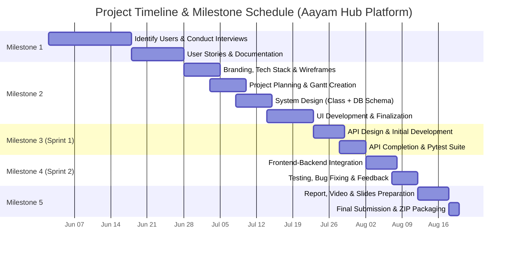

# Milestone 2 Research & Resource Document
## Project Tools, Gantt Chart, Kanban Board & Frontend Interface Specifications

### Context & Project Metadata
* **Software Name:** Aayam (Cultural Club Operations Platform / IIT BS Drama Society Platform)
* **Department Context:** IIT BS Cultural & Drama Club Department
* **System Type:** Community Engagement, Resource Allocation & Club Management Platform
* **Team Name:** ServiceSync
* **Team Code:** Team-070
* **Institution:** IITM Online BS Degree Program, Indian Institute of Technology Madras, Chennai, Tamil Nadu, India, 600036
* **Submission Date:** 28-06-2026 (May 2026 Term Alignment)
* **Team Details:**
  * **Jatin Bhardwaj** (23f2004867) — Scrum Master / Frontend Dev
  * **Amit Kumar Patra** (21f1000426) — Frontend Dev / Backend Dev
  * **Shibin Mohammed N P** (23f2005132) — Product Manager / Code Reviewer
  * **Devi Vrinda A** (21f1001205) — Product Manager / Code Reviewer
  * **Bhabani Kundu** (21f3000243) — Backend Dev / Tester
* **Resource Type:** Technical Research, Scheduling & Frontend UI Specifications

---

## 1. PROJECT SCHEDULING & TRACKING TOOLS

To manage the development of the **Aayam** platform effectively, visual task management and scheduling tools were utilized to organize work across different phases, align team member responsibilities, and ensure timely completion of project milestones.

### 1.1 Summary of Tools Used

| Tool | Category | Primary Function | Key Value Provided |
| :--- | :--- | :--- | :--- |
| **Kanban Board (GitHub Projects)** | Visual Task Management | Workflows, ticket statuses, and task allocation | Provides real-time visibility into task progress, active bottlenecks, and individual bandwidth. |
| **GitHub Issues & PRs** | Bug & Code Tracking | Issue logging, bug tracking, and code reviews | Ensures full traceability between user stories, code commits, pull requests, and bug resolutions. |
| **Gantt Chart (Excel / Matplotlib)** | Schedule & Timeline Visualization | High-level schedule and dependency mapping | Displays start/end dates, milestone deadlines, and parallel development workstreams. |
| **Stitch** | UI/UX Prototyping & Design Systems | High-fidelity wireframing and UI variant generation | Early visual validation of dashboard designs against Milestone 1 user requirements. |
| **Draw.io** | System Architecture Modeling | Class diagrams and database ER diagrams | Visual modeling of domain classes and database schema relationships (`aayam.db`). |
| **Discord & Google Meet** | Team Communication & SCRUM | Async daily standups and weekly meetings | Enables fast resolution of blockers and documentation of meeting minutes. |

### 1.2 Tool Descriptions & Workflow Integration

* **Kanban Board (Task Management):** We primarily used a Kanban board to manage and track task progress throughout the project lifecycle. Tasks were categorized into columns representing development stages (*Backlog, To Do, In Progress, In Review, Done*). This structure enhanced transparency across frontend (React/Tailwind) and backend (Flask/SQLite) workstreams, ensuring all team members had clear visibility into task ownership.
* **GitHub Issues (Bug & Issue Tracking):** For issue tracking during development and testing, GitHub Issues was used to log bugs, blockers, and feature enhancements. Each issue was assigned priority tags (P0, P1, P2), linked to relevant user stories (e.g., practice room booking, script builder AI integration), and tracked until resolution to maintain a complete audit log.
* **Gantt Chart (Project Timeline):** A Gantt chart was created to represent the complete project schedule across all milestones and sprints from June to August 2026. It provided a high-level view of deadlines, critical path dependencies, and overlapping tasks, ensuring that planning, UI design, API development, integration, and testing were completed on schedule.
* **Stitch (UI Prototyping & Design Systems):** We utilized Stitch for UI/UX prototyping, design system generation, and creating screen variants across Aayam's core user roles (Member Dashboard, AI Rehearsal Studio, Production Office, Maintainer Control Panel). This enabled rapid visual validation of UI layouts against Milestone 1 user stories prior to React implementation.
* **Discord & Google Meet (Team Communication & SCRUM):** We used Discord text/voice channels for daily asynchronous standup updates, real-time developer coordination, and quick technical discussions, alongside scheduled Google Meet sessions for weekly SCRUM progress reviews and milestone demonstrations.

### 1.3 Expected Outcomes & Benefits
The integration of these scheduling tools enabled:
* **Efficient Tracking:** Seamless monitoring of task progress across individual sprints.
* **Workflow Clarity:** Clear visual representation of active workstreams and task handoffs.
* **Proper Issue Documentation:** Systematic logging and resolution of software bugs and technical debt.
* **On-Time Delivery:** Disciplined adherence to project milestones and final submission deadlines.

---

## 2. PROJECT GANTT CHART & SCHEDULE TIMELINE

### 2.1 Overview & Description
The Gantt chart represents the complete project timeline from **Milestone 1 (User Requirement Analysis)** to **Milestone 5 (Final Submission)**. It provides a visual representation of all major phases, including planning, system design, API development, frontend-backend integration, testing, and final delivery.

The project schedule is structured into sequential milestones and overlapping sprints:
* **Milestone 1 (User Requirement Analysis):** Focuses on identifying user requirements through interviews with Club Secretary Siddharth Sahu, active performers, prospective members, and sponsors, leading to 13 SMART user stories.
* **Milestone 2 (Planning & Design):** Covers planning and design activities, including project scheduling, Gantt chart creation, system architecture (class diagrams, ER schema for `aayam.db`), and frontend UI prototyping.
* **Sprint 1 / Milestone 3 (API Development):** Focuses on core backend API design (Flask REST endpoints), database models, and automated testing with Pytest.
* **Sprint 2 / Milestone 4 (Testing & Integration):** Focuses on connecting React frontend components to backend APIs, conducting end-to-end user flow testing, and fixing integration bugs.
* **Milestone 5 (Final Submission):** Involves final testing, report compilation, video demonstration recording, and final ZIP packaging.

### 2.2 Detailed Gantt Chart Task Table

Below is the complete schedule task table detailing task names, start dates, and end dates as derived from the updated Gantt chart (`gantt_chart_updated.png`).

| WBS # | Task Name | Start Date | End Date |
| :---: | :--- | :---: | :---: |
| **1.0** | **Milestone 1 - User Requirement Analysis** | **02-06-2026** | **28-06-2026** |
| 1.1 | Identify Users & Conduct Interviews | 02-06-2026 | 18-06-2026 |
| 1.2 | User Stories & Documentation | 18-06-2026 | 28-06-2026 |
| **2.0** | **Milestone 2 - Planning & Design** | **28-06-2026** | **23-07-2026** |
| 2.1 | Branding, Tech Stack & Wireframes | 28-06-2026 | 05-07-2026 |
| 2.2 | Project Planning & Gantt Creation | 03-07-2026 | 10-07-2026 |
| 2.3 | System Design (Class Diagram + DB Design) | 08-07-2026 | 15-07-2026 |
| 2.4 | UI Development & Linking | 14-07-2026 | 23-07-2026 |
| 2.5 | Documentation & Finalization (Milestone 2) | 18-07-2026 | 23-07-2026 |
| **3.0** | **Sprint 1 - API Development (Milestone 3)** | **23-07-2026** | **02-08-2026** |
| 3.1 | API Design & Initial Development | 23-07-2026 | 29-07-2026 |
| 3.2 | API Completion & Testing | 28-07-2026 | 02-08-2026 |
| **4.0** | **Sprint 2 - Integration & Testing (Milestone 4)** | **02-08-2026** | **12-08-2026** |
| 4.1 | Frontend-Backend Integration | 02-08-2026 | 08-08-2026 |
| 4.2 | Testing, Bug Fixing & Feedback | 07-08-2026 | 12-08-2026 |
| **5.0** | **Milestone 5 - Final Submission** | **12-08-2026** | **20-08-2026** |
| 5.1 | Final Report, Video & Slides Preparation | 12-08-2026 | 18-08-2026 |
| 5.2 | Final Submission & ZIP Bundling | 18-08-2026 | 20-08-2026 |

### 2.3 Textual Visualization of Gantt Timeline (Mermaid Diagram)

### 2.4 Key Features & Critical Path Analysis
* **Timeline Clarity:** Clearly outlines start dates, end dates, and target milestones for the Aayam project.
* **Parallel Workstream Execution:** Represents concurrent tasks (e.g., UI development running alongside database schema design and SQLite seed data preparation).
* **Phase Dependency Mapping:** Enforces clear task sequence: *Design $\rightarrow$ API Development $\rightarrow$ Integration $\rightarrow$ Testing $\rightarrow$ Final Delivery*.
* **Time Management:** Prevents bottlenecks by allocating dedicated buffer periods for integration and testing.

---

## 3. PROJECT TRACKING MECHANISM (KANBAN BOARD)

### 3.1 Overview
To effectively manage and track project progress for **Aayam**, a **Kanban board** was used as the primary project tracking tool. It provided visual representation of tasks across different stages of development, ensuring transparency and efficient workflow management across team members (Jatin, Amit, Shibin, Devi Vrinda, Bhabani).

### 3.2 Board Column Structure
The Kanban board was structured into 5 columns representing task status:
1. **Backlog:** Tasks planned for future phases (e.g., confidential grievance portal, external workshop booking engine) but not yet started.
2. **To Do:** Priority tasks refined and ready to be picked up by team members.
3. **In Progress:** Tasks currently actively being developed (WIP limits applied to maintain focus).
4. **In Review:** Tasks undergoing code review, UI verification, or document proofreading.
5. **Done:** Completed tasks that meet the Definition of Done (DoD).

### 3.3 Ticket Governance & Metadata
Each task was represented as a card containing:
* **Task Title & Description:** Clear summary of task scope and acceptance criteria.
* **Priority Level:** Classified as P0 (Critical/Blocker), P1 (High Priority), P2 (Normal), or P3 (Low).
* **Assignee:** Single point of accountability assigned to each card (e.g., Jatin for Frontend, Bhabani for Backend API, Shibin for Code Review).
* **Milestone Tagging:** Explicit labels such as `[M2][Frontend]`, `[M3][API]`, or `[M4][Integration]`.
* **GitHub Integration:** Direct linking between Kanban cards, GitHub Issues, and Pull Requests.

### 3.4 Outcomes Achieved
The Kanban board framework contributed to:
* **Efficient Task Tracking:** Seamless visibility into active development items.
* **Enhanced Coordination:** Improved team communication and individual accountability.
* **WIP Control:** Prevention of task overload by limiting work-in-progress items.
* **Timely Deliverables:** Reliable progress tracking resulting in on-time milestone submissions.

---

## 4. FRONTEND INTERFACE SCREENS SPECIFICATIONS & RESEARCH

The frontend of **Aayam (IIT BS Drama Society Platform)** is designed to support multiple user roles (Club Members, Core Leadership, New Applicants, System Maintainers, Sponsors, and External Partners), each with a dedicated dashboard tailored to their specific operational responsibilities.

Below are the comprehensive text specifications for the core frontend modules and interface screens developed in React and Tailwind CSS.

### 4.1 Landing Page & Public Cultural Portal (`Home.tsx`, `website_landing/`)
Designed as the public digital storefront for the Aayam Drama Society to engage prospective members, showcase past productions, and publish upcoming event schedules.
* **Hero Banner & Production Spotlight:** Dynamic banner highlighting flagship productions (e.g., *Matinee Club*, annual stage plays) with trailer video embeds and ticket booking CTAs.
* **Public Event & Audition Announcement Feed:** Visual cards showcasing upcoming street plays, stage auditions, and workshop schedules with date, venue, and eligibility criteria.
* **Society Impact Statistics:** Performance indicators showcasing total active members, past shows conducted, total audience reach, and awards won.
* **Quick Access Navigation:** One-click navigation routing users to Member Login, New Applicant Registration (`JoinClub.tsx`), Production Office, and Sponsor Portal.

### 4.2 Join Club & Onboarding Portal (`JoinClub.tsx`)
A guided digital recruitment wizard designed to streamline member onboarding and eliminate physical paper application forms.
* **Interest Track Selection:** Multi-track selection interface allowing applicants to choose preferred sub-groups (Acting, Scriptwriting, Directing, Stage Management, Costume & Makeup, Sound & Lighting).
* **Portfolio & Media Sample Upload:** Drag-and-drop file uploader supporting headshots, voice clips, monologue videos, and portfolio PDFs.
* **Audition Slot Picker:** Interactive calendar allowing applicants to reserve specific audition time slots without scheduling conflicts.
* **Real-Time Application Status Tracker:** Visual progress bar allowing applicants to monitor their application status (*Submitted, Under Review, Audition Scheduled, Selected, Onboarded*).

### 4.3 Member Dashboard & Personal Workspace (`MemberDashboard.tsx`, `MySchedule.tsx`, `MemberPlays.tsx`, `MemberScripts.tsx`)
A personalized operational hub for active drama club members, cast, and crew.
* **Personalized Schedule & Call Times (`MySchedule.tsx`):** Timeline feed displaying assigned rehearsal timings, call times, practice room reservations, and assigned production duties.
* **Rehearsal Room & Space Reservation Engine:** Calendar booking interface enabling members to reserve open practice rooms up to 7 days in advance with automated double-booking prevention.
* **Script & Play Access Library (`MemberPlays.tsx`, `MemberScripts.tsx`):** Digital library providing access to approved play scripts, character breakdowns, and rehearsal audio notes.
* **Artistic Profile & Skill Portfolio (`ViewProfile.tsx`, `EditProfile.tsx`):** Profile management screen allowing members to maintain verified records of past roles, artistic skills, availability, and emergency contacts.

### 4.4 AI Rehearsal Studio & Script Builder (`AiRehearsalStudio.tsx`, `ScriptBuilder.tsx`)
An innovative GenAI-powered creative workspace designed for scriptwriting and line practice.
* **Interactive Script Builder (`ScriptBuilder.tsx`):** Professional script formatting editor supporting character dialog tagging, scene descriptions, and act structuring.
* **AI Dialog & Scene Generation:** Gemini AI-assisted writer helping playwrights generate character dialogues, scene transitions, and creative plot twists.
* **AI Line Practice & Partner Simulation (`AiRehearsalStudio.tsx`):** Voice/text AI practice partner that reads opposing character lines in real time so actors can practice line delivery independently.

### 4.5 Production Office & Backstage Pass (`ProductionOffice.tsx`, `ProductionWorkspace.tsx`, `BackstagePass.tsx`)
An administrative control center designed for Club Leadership (Secretary Siddharth Sahu, Directors, Event Organizers).
* **Casting & Audition Management Console:** Interface allowing leaders to review audition recordings, rate applicant performances, and assign play roles with one click.
* **Stage Equipment Issue & Inventory Tracker:** Digital checkout log for stage gear (microphones, sound amplifiers, costumes, props) tracking item issuance, borrower member IDs, and return status.
* **Production Call Sheet Generator:** Workspace tool to generate and distribute daily production call sheets to cast and crew members.
* **Budget & Expense Tracking:** Expense logging table enabling organizers to record production expenses and upload digital receipt images for reimbursement processing.

### 4.6 Maintainer & Admin Control Panel (`MaintainerDashboard.tsx`, `AllMembersDirectory.tsx`, `AuditionsManagement.tsx`, `ProductionControlPanel.tsx`, `ComplianceLedger.tsx`, `PlatformAnalytics.tsx`, `MediaModeration.tsx`)
A comprehensive system administration suite for technical leads, system maintainers, and regulatory oversight representatives.
* **All-Members Directory & RBAC Governance (`AllMembersDirectory.tsx`):** Comprehensive user database allowing administrators to manage user accounts, update Role-Based Access Controls (RBAC), and trigger annual committee account handovers.
* **Compliance & Financial Audit Ledger (`ComplianceLedger.tsx`):** View-only ledger for institute authorities (Student Affairs Office, Faculty Coordinators) to audit financial transactions, event safety plans, and facility usage logs.
* **Confidential Misconduct & Grievance Log:** Sequestered portal allowing students to submit confidential safety or behavioral grievances directly to institute authorities.
* **Platform Analytics & Media Moderation (`PlatformAnalytics.tsx`, `MediaModeration.tsx`):** Analytics dashboard tracking system usage, active user retention, and media content moderation queues.

### 4.7 Sponsor & External Partner Portal (`SponsorDashboard.tsx`)
Dedicated portal for advertisers, sponsors, and partner educational institutions.
* **Audience Reach & Media Analytics:** Executive dashboard showcasing verified audience reach numbers, past play recordings, and event metrics to justify sponsorship funding.
* **Sponsorship Package Selector:** Interactive catalog displaying available sponsorship tiers (Title Sponsor, Gold, Silver, Prop Integration) with online proposal submission.
* **Brand Asset Uploader:** Secure file drop zone for sponsors to upload high-resolution digital logos, promotional banners, and prop integration guidelines.
* **Institutional Workshop Request Engine:** Booking module enabling external schools and colleges to request drama workshops, specify audience sizes, and reserve preferred workshop dates.

---

## 5. SUMMARY OF RESOURCE DOCUMENTATION

This document consolidates the technical research, project scheduling tools, Gantt chart task timeline, Kanban board tracking rules, and detailed frontend interface specifications for **Aayam (IIT BS Drama Society Platform)** under Milestone 2.
