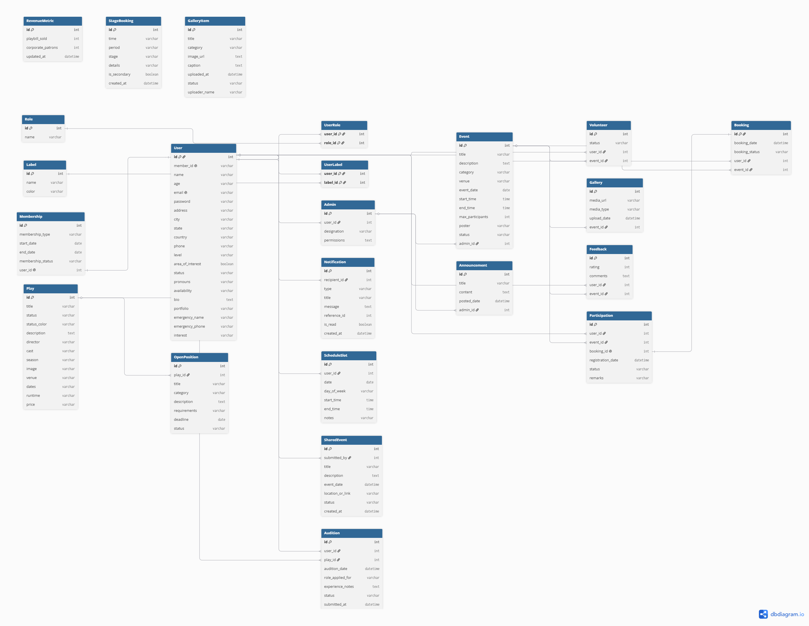

# Database Design – ER Diagram

## Overview

The ER (Entity-Relationship) diagram represents the database structure of the **Aayam (Cultural Club Operations Platform)**, defining entities, attributes, and relationships required for efficient data management. It captures how different components such as **User, UserRole, UserLabel, Label, Membership, Event**, and other entities are interconnected at the database level.

## Key Highlights

- Defines relationships such as:
  - **One-to-Many:** User → Booking, Event → Booking, User → Feedback
  - **Many-to-One:** Booking → User, Booking → Event, Volunteer → Event
  - **Many-to-Many:** User ↔ Role, User ↔ Label
- Ensures data integrity and consistency across all modules.
- User-centric design, where all activities are linked back to a single user profile.
- Optimized for efficient querying and scalability.

## ER Diagram

