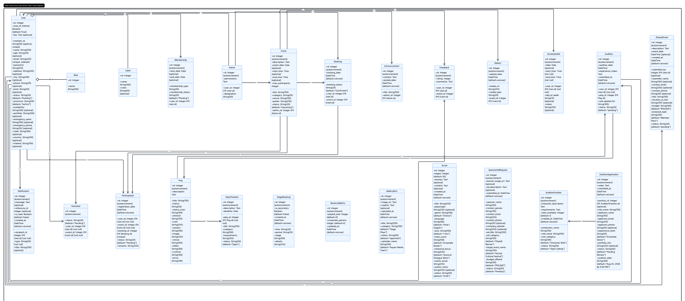

# System Design – Class Diagram

## Overview

The class diagram represents the complete system architecture of the **Aayam Drama Club Management System**, consisting of interconnected classes organized across multiple functional modules. It illustrates the relationships between core entities such as **User**, **Admin**, **Event**, **Play**, **Audition**, **Booking**, **Participation**, **Membership**, and **Volunteer**, providing a modular and scalable architecture for managing club operations, theatrical productions, and member engagement.

The design models the complete workflow of the drama club—from member registration and event management to auditions, production planning, volunteering, notifications, and feedback—while maintaining strong relationships between entities through a normalized database structure.

---

## Key Highlights

- Covers **10 major modules** including User Management, Membership, Administration, Event Management, Production Management, Auditions, Scheduling, Media, Community Engagement, and Notifications.

- Clearly defines relationships between core entities such as **User**, **Admin**, **Event**, **Booking**, **Participation**, **Play**, **Audition**, **Membership**, **Volunteer**, and **Feedback**, accurately representing real-world drama club operations.

- Supports complete theatre workflows, including member registration, event organization, booking, participation tracking, volunteer management, auditions, role recruitment, production management, announcements, and media galleries.

- Implements **Role-Based Access Control (RBAC)** through a flexible User–Role relationship, enabling different permissions for administrators, members, volunteers, and other club roles.

- Follows a normalized database design, minimizing redundancy by separating business entities and connecting them through well-defined primary and foreign key relationships.

- Designed for scalability and modular development, allowing future extensions such as ticketing, costume management, rehearsal attendance, payment processing, sponsorship management, or AI-powered audition screening without major architectural changes.

---

## Class Diagram

The following UML class diagram illustrates the structure of the system and the relationships between the primary classes.

