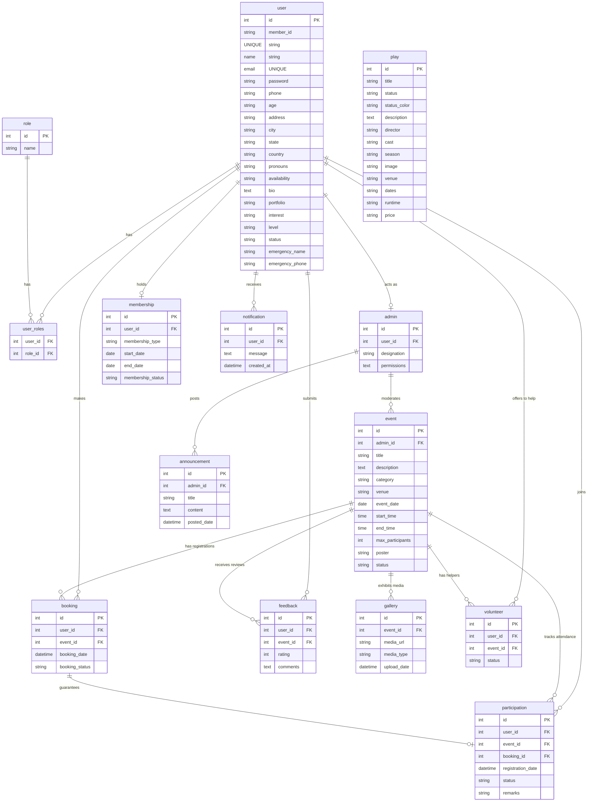

# AAYAM Hub — Database Schema & Data Dictionary

This document outlines the SQLite database structure (`aayam.db`) powering the AAYAM Hub and Matinee Club backend. It includes the schema design, table definitions, relationships, and a summary of the seeded data.

---

## 📊 Entity Relationship Diagram

The following Mermaid diagram visualizes the tables and relationships defined in [models.py](file:///Users/jatinbhardwaj/Github/software_project/backend/models.py).



---

## 🗂️ Data Dictionary

### 1. `user`
Stores member profiles, contact info, emergency details, and login credentials.

| Column | Type | Constraints | Description |
| :--- | :--- | :--- | :--- |
| `id` | INTEGER | PRIMARY KEY | Unique user record identifier. |
| `member_id` | VARCHAR(50) | UNIQUE, NULLABLE | Public club membership token (e.g. `MC-1001`). |
| `name` | VARCHAR(150) | NOT NULL | User's full name. |
| `email` | VARCHAR(255) | UNIQUE, NOT NULL, INDEX | Primary email (auto-generated as `name@handle.com`). |
| `password` | VARCHAR(512) | NOT NULL | Securely hashed password credential. |
| `phone` | VARCHAR(20) | NULLABLE | Primary phone number (with country code). |
| `age` | VARCHAR(20) | NULLABLE | Age bracket or age. |
| `address` | VARCHAR(255) | NULLABLE | Local residential address. |
| `city` | VARCHAR(100) | NULLABLE | City. |
| `state` | VARCHAR(100) | NULLABLE | State (e.g. Maharashtra, Karnataka). |
| `country` | VARCHAR(100) | NULLABLE | Country (default: India). |
| `pronouns` | VARCHAR(50) | NULLABLE | Pronouns preference (e.g. he/him). |
| `availability`| VARCHAR(100) | NULLABLE | Rehearsal/performance slots. |
| `bio` | TEXT | NULLABLE | Professional summary or theatrical journey. |
| `portfolio` | VARCHAR(200) | NULLABLE | Links to external works/resumes. |
| `interest` | VARCHAR(100) | NULLABLE | Theatrical areas of interest. |
| `level` | VARCHAR(50) | NULLABLE | Experience level classification (e.g., Ensemble). |
| `status` | VARCHAR(20) | DEFAULT 'Pending' | Member status (Active, On Break, Pending). |
| `emergency_name` | VARCHAR(100)| NULLABLE | Emergency contact person name. |
| `emergency_phone`| VARCHAR(20) | NULLABLE | Emergency contact phone number. |

### 2. `role` & `user_roles`
Defines permission tags in the Matinee Club.

* **`role` Table:**
  * `id` (INTEGER, PK)
  * `name` (VARCHAR(100), NOT NULL) — e.g. `Core Maintainer`, `Director Coordinator`, `Lead Actor & Member`.
* **`user_roles` Table (Association):**
  * `user_id` (INTEGER, FK -> `user.id`, PK)
  * `role_id` (INTEGER, FK -> `role.id`, PK)

### 3. `play`
Details the theatrical productions staged by the club.

| Column | Type | Constraints | Description |
| :--- | :--- | :--- | :--- |
| `id` | INTEGER | PRIMARY KEY | Unique play identifier. |
| `title` | VARCHAR(150) | NOT NULL | Title of the play (e.g. Tughlaq). |
| `status` | VARCHAR(50) | NULLABLE | Ticket status (e.g. SELLING FAST). |
| `status_color` | VARCHAR(100) | NULLABLE | Style class string for color rendering. |
| `description` | TEXT | NULLABLE | Detailed play synopsis. |
| `director` | VARCHAR(150) | NULLABLE | Name of the director. |
| `cast` | VARCHAR(255) | NULLABLE | Comma-separated list of lead performers. |
| `season` | VARCHAR(100) | NULLABLE | The staging season (e.g. Monsoon 2026 Season). |
| `image` | VARCHAR(255) | NULLABLE | Image URL for the playbill poster. |
| `venue` | VARCHAR(100) | NULLABLE | Primary theatre venue (e.g. Prithvi Theatre). |
| `dates` | VARCHAR(100) | NULLABLE | Date range of playruns. |
| `runtime` | VARCHAR(100) | NULLABLE | Total play run time. |
| `price` | VARCHAR(100) | NULLABLE | Staging price info (e.g. Tickets from ₹300). |

### 4. `event`
Tracks scheduled events, rehearsals, workshops, and meetups.

| Column | Type | Constraints | Description |
| :--- | :--- | :--- | :--- |
| `id` | INTEGER | PRIMARY KEY | Unique event identifier. |
| `title` | VARCHAR(150) | NOT NULL | Title of the event. |
| `description` | TEXT | NULLABLE | Event details. |
| `category` | VARCHAR(50) | NULLABLE | Category (Plays, Workshops, Meetups). |
| `venue` | VARCHAR(100) | NULLABLE | Staging hall or studio room. |
| `event_date` | DATE | NULLABLE | Calendar date. |
| `start_time` | TIME | NULLABLE | Starting time. |
| `end_time` | TIME | NULLABLE | Finishing time. |
| `max_participants`| INTEGER | NULLABLE | Capacity cap. |
| `poster` | VARCHAR(255) | NULLABLE | Media URL for the event graphic. |
| `status` | VARCHAR(20) | DEFAULT 'Upcoming' | Lifecycle stage (Upcoming, Concluded). |
| `admin_id` | INTEGER | FK -> `admin.id` | Coordinator responsible for scheduling. |

---

## 🗃️ Seeding Statistics (Current Status)

The database has been seeded with a rich, regional, and gender-diverse set of Indian data:

| Metric | Count | Highlighted Data |
| :--- | :---: | :--- |
| **Ensemble Members** | 10 | Sneha Vyas, Kabir Mehta, Jayesh Dave, Pooja Patel, Priya Nair, Amit Sharma |
| **Admins** | 6 | Sneha Vyas (Director), Kabir Mehta (Tech), Siddharth Verma (Backstage), Amit Sharma (Casting), Rohan Sen (Choreography), Pooja Patel (Art) |
| **Active Plays** | 7 | *Tughlaq* (Mumbai), *Andha Yug* (Delhi), *Hayavadana* (Bengaluru), *Charandas Chor* (New Delhi), *Ebong Indrajit* (Kolkata), *Sakharam Binder* (Pune), *Karnabhari* (Kochi). |
| **Events** | 9 | *Tughlaq Premiere*, *Natya Shastra acting workshop*, *Marathi Realistic Drama Panel*, *Badal Sircar Third Theatre Workshop*, *Yakshagana Physical Intensive*. |

---

## 🛠️ How to Connect and Query (Quick Reference)

### Using Python Shell (`app.app_context`):
```python
from app import app
from models import db, User, Play, Event

with app.app_context():
    # Count all plays
    plays_count = Play.query.count()
    print(f"Total plays in DB: {plays_count}")
    
    # Retrieve a specific user
    user = User.query.filter_by(email="sneha@handle.com").first()
    print(f"User: {user.name}, Role: {user.roles[0].name if user.roles else 'None'}")
```

### Using SQLite3 CLI:
```bash
sqlite3 backend/aayam.db
# Within sqlite3 terminal:
.tables
SELECT title, director, venue FROM play;
SELECT name, email FROM user WHERE status='Active';
```
