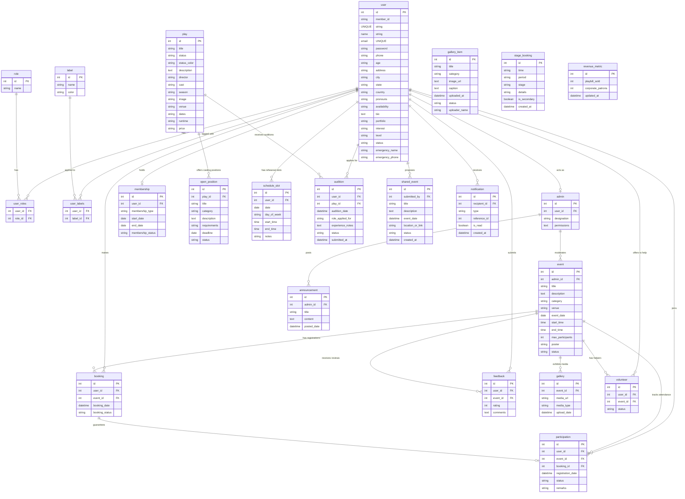

# AAYAM Hub — Database Schema & Data Dictionary

This document outlines the SQLite database structure (`aayam.db`) powering the AAYAM Hub and Matinee Club backend. It includes the complete schema design, table definitions, relationships, and a summary of the authentic seeded data from the Aayam Drama Society (IIT Madras BS).

---

## 📊 Entity Relationship Diagram

The following Mermaid diagram visualizes the tables and relationships defined in [models.py](file:///Users/jatinbhardwaj/Github/software_project/backend/models.py).



---

## 🗂️ Data Dictionary

### 1. `user`
Stores member profiles, contact info, emergency details, local profile images, and login credentials.

| Column | Type | Constraints | Description |
| :--- | :--- | :--- | :--- |
| `id` | INTEGER | PRIMARY KEY | Unique user record identifier. |
| `member_id` | VARCHAR(50) | UNIQUE, NULLABLE | Public club membership token (e.g. `MC-1001`). |
| `name` | VARCHAR(150) | NOT NULL | User's full name. |
| `email` | VARCHAR(255) | UNIQUE, NOT NULL, INDEX | Primary email (e.g., `23f2000668@ds.study.iitm.ac.in`). |
| `password` | VARCHAR(512) | NOT NULL | Securely hashed password credential. |
| `phone` | VARCHAR(20) | NULLABLE | Primary phone number (with country code). |
| `age` | VARCHAR(20) | NULLABLE | Age. |
| `address` | VARCHAR(255) | NULLABLE | Residential or campus address. |
| `city` | VARCHAR(100) | NULLABLE | City (e.g. Chennai, Mumbai, Pune). |
| `state` | VARCHAR(100) | NULLABLE | State. |
| `country` | VARCHAR(100) | NULLABLE | Country (default: India). |
| `pronouns` | VARCHAR(50) | NULLABLE | Pronouns preference. |
| `availability`| VARCHAR(100) | NULLABLE | Rehearsal/performance availability. |
| `bio` | TEXT | NULLABLE | Professional summary or theatrical journey. |
| `portfolio` | VARCHAR(200) | NULLABLE | Links to external portfolio or Google site. |
| `interest` | VARCHAR(100) | NULLABLE | Theatrical areas of interest. |
| `level` | VARCHAR(50) | NULLABLE | Experience level classification (e.g., Ensemble Leader). |
| `status` | VARCHAR(20) | DEFAULT 'Active' | Member status (Active, On Break, Pending). |
| `emergency_name` | VARCHAR(100)| NULLABLE | Emergency contact person name. |
| `emergency_phone`| VARCHAR(20) | NULLABLE | Emergency contact phone number. |

### 2. `role` & `user_roles`
Defines permission tags in the Aayam Drama Society.

* **`role` Table:**
  * `id` (INTEGER, PK)
  * `name` (VARCHAR(100), NOT NULL) — e.g. `Core Maintainer`, `Production Coordinator`, `Outreach & Sponsorship Head`, `Mentor (Directing)`, `Design Head`.
* **`user_roles` Table (Association):**
  * `user_id` (INTEGER, FK -> `user.id`, PK)
  * `role_id` (INTEGER, FK -> `role.id`, PK)

### 3. `play` & `open_position`
Details the active theatrical productions staged by Aayam.

* **`play` Table:**
  * `id` (INTEGER, PK)
  * `title` (VARCHAR(150), NOT NULL) — e.g. *Tamashbin Kathputliya*, *DDDJ*, *Karn Ki Yachika*, *Samatvam*, *Speak Up Tara*.
  * `status` (VARCHAR(50)) — Ticket status (e.g. `FEATURED MATINEE`, `SELLING FAST`).
  * `status_color` (VARCHAR(100)) — Color utility badge style.
  * `description` (TEXT) — Detailed play synopsis.
  * `director` (VARCHAR(150)) — Lead director.
  * `cast` (VARCHAR(255)) — Featured ensemble performers.
  * `season` (VARCHAR(100)) — Season name (e.g. `2024-2025 Lineage`).
  * `image` (VARCHAR(255)) — Authentic photo path under `/aayam_assets/`.
  * `venue` (VARCHAR(100)) — Performance venue (e.g., `OAT IIT Madras`).

* **`open_position` Table:**
  * `id` (INTEGER, PK)
  * `play_id` (INTEGER, FK -> `play.id`) — Associated play.
  * `title` (VARCHAR(150)) — Position title (e.g., `Female Lead - Tara`).
  * `category` (VARCHAR(100)) — Category (`Acting`, `Crew`, `Directing`).
  * `requirements` (VARCHAR(255)) — Casting requirements.

### 4. `gallery_item`
Maintains the authentic production photo library (60+ items).

| Column | Type | Constraints | Description |
| :--- | :--- | :--- | :--- |
| `id` | INTEGER | PRIMARY KEY | Unique media record identifier. |
| `title` | VARCHAR(200) | NOT NULL | Descriptive theatrical title. |
| `category` | VARCHAR(100) | DEFAULT 'Stage Plays' | Play folder category (Tamashbin Kathputliya, DDDJ, KKY, Samatvam, Speak Up Tara). |
| `image_url` | TEXT | NOT NULL | Path to image (e.g. `/aayam_assets/tamashbin_user_1.jpg`). |
| `caption` | TEXT | NULLABLE | Production scene caption. |
| `uploaded_at` | DATETIME | DEFAULT UTC | Upload timestamp. |
| `status` | VARCHAR(50) | DEFAULT 'approved' | Approval status. |
| `uploader_name`| VARCHAR(100)| DEFAULT 'Aayam Media Team' | Credit attribution. |

---

## 🗃️ Seeding Statistics (Current Status)

The database is seeded with authentic data from the **Aayam (IIT Madras BS Drama Society)** 2024-2025 ensemble:

| Metric | Count | Highlighted Data |
| :--- | :---: | :--- |
| **Ensemble Members** | 21 | Abay Nandhiga (Secretary), Yuuhi (Deputy Secretary), Samarth Shrivastava (Chief Coordinator), Krishna Subramanian (Dept. Chief Coordinator), Harsh Aryan (Tech Lead), Swati Singh (Content Head), Sneha Das (Design Head), Tanu Kurade, S. Sri Vaishnavi, Akanksha Kadam, Anshi Jain, Kaushal Raj, Esha Hinde, Kanishk Mishra, Aditi. |
| **Maintainers / Admins** | 4 | Abay Nandhiga, Yuuhi, Samarth Shrivastava, Swati Singh. |
| **Active Staged Plays** | 5 | *Tamashbin Kathputliya* (Street Play), *DDDJ* (Dramatic Showcase), *Karn Ki Yachika* (Classical Drama), *Samatvam* (Physical Movement), *Speak Up Tara* (Social Drama). |
| **Events & Workshops** | 6 | *Tamashbin Premiere*, *Natya Shastra Acting Intensive*, *Acoustic Sound & Lighting Workshop*, *Street Theatre Courtyard Showcase*. |
| **Authentic Gallery Items** | 60 | Real production performance photos imported from user media folders with descriptive theatrical titles. |

---

## 🛠️ How to Connect and Query (Quick Reference)

### Using Python Shell (`app.app_context`):
```python
from app import app
from models import db, User, Play, Event, GalleryItem

with app.app_context():
    # Count all authentic gallery items
    gallery_count = GalleryItem.query.count()
    print(f"Total media items in DB: {gallery_count}")
    
    # Retrieve Secretary profile
    user = User.query.filter_by(name="Abay Nandhiga").first()
    print(f"User: {user.name}, Email: {user.email}, Role: {user.roles[0].name if user.roles else 'None'}")
```

### Using SQLite3 CLI:
```bash
sqlite3 backend/aayam.db
# Within sqlite3 terminal:
.tables
SELECT title, category, image_url FROM gallery_item LIMIT 10;
SELECT name, email, city FROM user WHERE status='Active';
```
